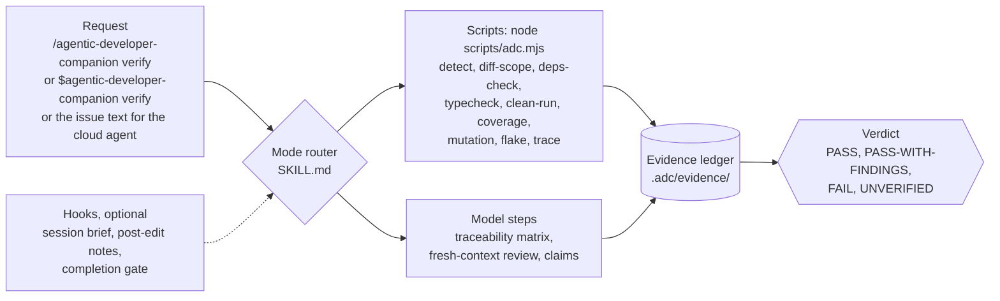
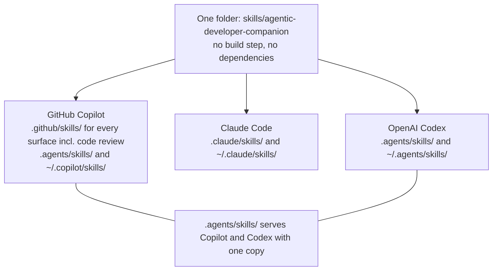

# 🧰 agentic-developer-companion

**Evidence, not claims.** One Agent Skill that checks the work of GitHub Copilot, Claude Code
and OpenAI Codex with a machine-written evidence ledger, and helps you build the agentic
tooling (instructions, skills, agents, hooks, plugins, MCP configs) those agents run on.

[](LICENSE)
[](https://github.com/robertlemmermann/agentic-developer-companion/tags)
[](https://agentskills.io/specification)

Version 0.1.0 (2026-10-25), the first public release. The skill lives in
[`skills/agentic-developer-companion/`](skills/agentic-developer-companion/SKILL.md); this
README and the [license](LICENSE) are the only files at the root.

## 🧭 What it is

Coding agents report "all tests pass" whether or not it is true, and the classic ways a
change goes wrong (deleted or skipped tests, weakened assertions, a CI step set to
`continue-on-error`, a hallucinated package) are hard to spot in a diff. This skill re-runs
the project's whole test suite on a snapshot of the uncommitted working tree, runs
diff-scoped tamper checks, and records every command, exit code and output hash in a ledger
that ends in one verdict: `PASS`, `PASS-WITH-FINDINGS`, `FAIL` or `UNVERIFIED`. Its second
job is treating agentic tooling as software: scaffolds, host-rule linting, measured context
cost, trigger evals and safe changes for Copilot, Claude Code and Codex alike.





A plain-text version of both diagrams is in
[install.md](skills/agentic-developer-companion/references/install.md#8-overview-diagrams-ascii).

## ✨ Features

**QA of agentic changes**

- ✅ **`verify`**: one command runs every scripted check on one working-tree snapshot and writes one ledger with a verdict.
- 📜 **Evidence ledger**: commands, exit codes, output hashes, chained entry hashes; claim status is derived from checks, never accepted from the agent.
- 🕵️ **Test-tamper detection**: deleted or renamed tests and test cases, skip and focus markers, weakened assertions, narrowed runner config, weakened CI steps, new lint or type suppressions, swallowed errors, in-source retries, secrets.
- 📦 **Dependency checks**: packages that do not exist, look-alike names, lockfile drift.
- 🧼 **Clean re-run of the uncommitted tree**: a snapshot including untracked files, checked out in a temp worktree, frozen install, the full suite with retries off, counts compared with the base.
- 📈 **Changed-line coverage**, 🧬 **mutation testing** on changed files, 🎲 **flake probe** with repeats and shuffling.
- 🔴🟢 **Red-green proof**: a new regression test must fail by assertion on the base and pass on the snapshot.
- 🧑‍⚖️ **Adversarial review** in a fresh context, with `file:line` citations and a reproduction step per critical item.
- 🧵 **Traceability**: spec requirements mapped to the diff, missing and extra functionality listed.
- 🧪 **Test engineering**: scaffolds for Playwright, API and CLI e2e suites, live and synthetic probes under a spend cap, regression tests, flake quarantine and CI gates, for Node, Python, Go, Rust, .NET, JVM and Ruby projects.

**Building agentic tooling**

- 🏗️ **Scaffold** instructions, skills, agents, prompt files, hooks, MCP configs and plugins per host.
- 🔍 **Lint** them against each host's documented rules, plus a security rule group.
- 💰 **Cost** and ⚡ **optimize**: always-on context per host, measured before and after.
- 🎯 **Eval**: trigger sets and outcome evals run headless in `claude -p`, `copilot -p` and `codex exec`.
- 🔀 **Port** between Copilot, Claude Code and Codex with a list of what gets lost.
- 🛠️ **Modify** safely (baseline, change, compare, accept or reject) and 📦 package **plugins** for your own projects.
- 🪝 **Hooks across hosts**: one handler, three output dialects, native Windows launch strings.

## 🧩 Works with

| Surface | Support | How it is invoked |
|---|---|---|
| Copilot CLI | ✅ | `/agentic-developer-companion <mode>` |
| VS Code (Session Target = Copilot) | ✅ | `/agentic-developer-companion <mode>` |
| GitHub Copilot app | ✅ repository and user skills, repository hooks | by name or description |
| Copilot cloud agent | ✅ automatic | the issue or PR names the skill and the mode |
| Copilot code review | ✅ automatic, reads `.github/skills/` only | by description |
| Visual Studio 18.5+, JetBrains (preview) | automatic | by description |
| Claude Code | ✅ | `/agentic-developer-companion <mode>` |
| OpenAI Codex | ✅ | `$agentic-developer-companion <mode>` |
| Windows, macOS, Linux | ✅ one zero-dependency Node runtime, no shell scripts, no symlinks | — |

Status of 0.1.0: the unit suites and the host CLIs (Copilot CLI 1.0.103, Claude Code 2.1.310,
Codex 0.164.0, gh 2.99.0) were exercised in a Linux container; the Windows and macOS rows of the
[manual matrix](tests/manual-matrix.md) are still open.
Per-host details and known gaps:
[host notes](skills/agentic-developer-companion/references/host-notes.md).

## 🚀 Install

You need **Git 2.31+**, **a supported host** from the table above, and **Node.js 24+** on
`PATH` for the scripts and hooks (without Node the skill still works in guidance-only mode).
Everything else is optional and has a fallback:
[PREREQUISITES.md](skills/agentic-developer-companion/PREREQUISITES.md).

| Host minimums | Copilot CLI | VS Code | Claude Code | Codex | GitHub CLI (`gh skill`) |
|---|---|---|---|---|---|
| Version | 1.0.88 | 1.109 | 2.1.269 (`claude plugin eval`; 2.1.295 for hook `onFailure`) | 0.124.0 (stable hooks; 0.164.0 for `/presets`) | 2.90.0 |

The `gh skill` commands below (GitHub CLI 2.90.0+, `gh skill` is in public preview) are
identical in bash, PowerShell and cmd. Run project-scope commands in the repository root.

**GitHub Copilot, a Copilot-only repository** (every surface, including code review):

```bash
gh skill install robertlemmermann/agentic-developer-companion agentic-developer-companion --dir .github/skills
```

**GitHub Copilot and Codex sharing one copy** (Copilot CLI, VS Code, Visual Studio, cloud
agent and Codex read `.agents/skills/`; code review needs the `.github/skills` copy as well):

```bash
gh skill install robertlemmermann/agentic-developer-companion agentic-developer-companion
gh skill install robertlemmermann/agentic-developer-companion agentic-developer-companion --dir .github/skills
```

**GitHub Copilot, just for you** (CLI, VS Code, Visual Studio; lands in `~/.copilot/skills/`):

```bash
gh skill install robertlemmermann/agentic-developer-companion agentic-developer-companion --scope user
```

Verify it loaded: `copilot skill list --json` lists `agentic-developer-companion`; in the
CLI run `/skills info agentic-developer-companion`; in VS Code type `/` in the chat box. The
cloud agent and code review read the copy committed to the default branch.

**Claude Code** (`.claude/skills/`, or `~/.claude/skills/` with `--scope user`):

```bash
gh skill install robertlemmermann/agentic-developer-companion agentic-developer-companion --agent claude-code
gh skill install robertlemmermann/agentic-developer-companion agentic-developer-companion --agent claude-code --scope user
```

Verify it loaded: type `/agentic-developer-companion help` in Claude Code.

**Codex** (`.agents/skills/`, or `~/.agents/skills/` with `--scope user`):

```bash
gh skill install robertlemmermann/agentic-developer-companion agentic-developer-companion --agent codex
gh skill install robertlemmermann/agentic-developer-companion agentic-developer-companion --agent codex --scope user
```

From inside Codex, ask `$skill-installer install https://github.com/robertlemmermann/agentic-developer-companion/tree/main/skills/agentic-developer-companion`
(it installs into `~/.codex/skills/` and needs a network escalation in the sandbox).
Verify it loaded: the `/skills` picker shows it, or `$agentic-developer-companion help`;
without signing in, `codex debug prompt-input "hello"` lists it under `<skills_instructions>`.

**Check the whole setup** with `doctor` (host, OS, Node, Git, every installed copy, hooks).
Adjust the path to the copy you installed:

```bash
node .agents/skills/agentic-developer-companion/scripts/adc.mjs doctor
```

```powershell
node .agents/skills/agentic-developer-companion/scripts/adc.mjs doctor
```

```bat
node .agents\skills\agentic-developer-companion\scripts\adc.mjs doctor
```

**Pin and update.** Without a version, `gh skill install` takes the latest tag. Pin with
`agentic-developer-companion@v0.1.0` or `--pin <tag-or-sha>`; at work pin the commit SHA of a
tag (look it up with `git ls-remote https://github.com/robertlemmermann/agentic-developer-companion refs/tags/v0.1.0`).
Update with `gh skill update --all` (pinned copies are skipped until `--unpin`). `gh skill`
rewrites the SKILL.md frontmatter with provenance keys inside `metadata`; that is expected.

<details>
<summary>No <code>gh</code>? Use <code>npx skills add</code>, <code>copilot skill add</code> or a plain <code>git clone</code></summary>

**Vercel `skills` CLI** (Node 22.20+; `--copy` writes real folders, so no symlink privileges
are needed on Windows; it also writes a `skills-lock.json` into the project):

```bash
npx skills add robertlemmermann/agentic-developer-companion -a github-copilot -a claude-code -a codex --copy
```

Add `-g` for user scope. **Copilot CLI, register a clone** (no copy; updates with `git pull`):

```bash
git clone --depth 1 https://github.com/robertlemmermann/agentic-developer-companion "$HOME/.copilot/adc" && copilot skill add "$HOME/.copilot/adc/skills"
```

```powershell
git clone --depth 1 https://github.com/robertlemmermann/agentic-developer-companion "$env:USERPROFILE\.copilot\adc"; copilot skill add "$env:USERPROFILE\.copilot\adc\skills"
```

```bat
git clone --depth 1 https://github.com/robertlemmermann/agentic-developer-companion "%USERPROFILE%\.copilot\adc" && copilot skill add "%USERPROFILE%\.copilot\adc\skills"
```

**Any host, clone and copy** (shown for Claude Code; use the host's user skill directory):

```bash
git clone --depth 1 https://github.com/robertlemmermann/agentic-developer-companion "$HOME/adc-src" && mkdir -p "$HOME/.claude/skills" && cp -R "$HOME/adc-src/skills/agentic-developer-companion" "$HOME/.claude/skills/"
```

```powershell
git clone --depth 1 https://github.com/robertlemmermann/agentic-developer-companion "$env:USERPROFILE\adc-src"; New-Item -ItemType Directory -Force "$env:USERPROFILE\.claude\skills" | Out-Null; Copy-Item -Recurse "$env:USERPROFILE\adc-src\skills\agentic-developer-companion" "$env:USERPROFILE\.claude\skills\"
```

```bat
git clone --depth 1 https://github.com/robertlemmermann/agentic-developer-companion "%USERPROFILE%\adc-src" && robocopy "%USERPROFILE%\adc-src\skills\agentic-developer-companion" "%USERPROFILE%\.claude\skills\agentic-developer-companion" /E
```

A junction instead of a copy needs no admin rights: PowerShell
`New-Item -ItemType Junction -Path "$env:USERPROFILE\.claude\skills\agentic-developer-companion" -Target "$env:USERPROFILE\adc-src\skills\agentic-developer-companion"`,
cmd `mklink /J "%USERPROFILE%\.claude\skills\agentic-developer-companion" "%USERPROFILE%\adc-src\skills\agentic-developer-companion"`.

</details>

**Uninstall.** Remove the hooks first, then delete every copy `doctor` lists:

```bash
node .agents/skills/agentic-developer-companion/scripts/adc.mjs setup hooks --remove
rm -rf .agents/skills/agentic-developer-companion
```

```powershell
node .agents/skills/agentic-developer-companion/scripts/adc.mjs setup hooks --remove
Remove-Item -Recurse -Force .agents\skills\agentic-developer-companion
```

```bat
node .agents\skills\agentic-developer-companion\scripts\adc.mjs setup hooks --remove
rmdir /S /Q .agents\skills\agentic-developer-companion
```

Installed with `npx skills`? `npx skills remove agentic-developer-companion`. Codex
`$skill-installer` refuses to overwrite, so delete `~/.codex/skills/agentic-developer-companion`
before reinstalling.

**Windows notes.** Install PowerShell 7 (`winget install Microsoft.PowerShell`) for Copilot
CLI and Codex hooks; Git for Windows for Claude Code's Bash tool. `node.exe` must be on the
`PATH` the hook launcher sees (Node from nvm, fnm or Volta: `setup hooks --node-path`).
Junctions and `--copy`, never symlinks, so Developer Mode is not needed. Deep temp
worktrees may need `git config --global core.longpaths true`. Codex hooks on native Windows:
confirm in `/hooks` that they fire. Long form: [install.md](skills/agentic-developer-companion/references/install.md).

## 🎛️ Use

| Host | Verify a change | Scaffold e2e | Lint tooling |
|---|---|---|---|
| Copilot CLI, VS Code, Claude Code | `/agentic-developer-companion verify origin/main` | `/agentic-developer-companion e2e web` | `/agentic-developer-companion tooling lint .github` |
| Codex | `$agentic-developer-companion verify origin/main` | `$agentic-developer-companion e2e web` | `$agentic-developer-companion tooling lint .github` |
| Copilot cloud agent (issue text) | "Use the agentic-developer-companion skill to verify this change and attach the evidence ledger." | "Use the agentic-developer-companion skill to scaffold Playwright e2e tests for the checkout flow." | "Use the agentic-developer-companion skill to lint the tooling under .github." |

**Headless and CI** (Copilot loads project skills in `-p` only in a trusted folder; name the
skill in prose; CI needs a Copilot-entitled token):

```bash
copilot -p "Use the agentic-developer-companion skill to verify origin/main" --trust-folder --no-ask-user --allow-tool 'shell(node:*)' --allow-tool 'shell(git:*)' --output-format json
claude -p "/agentic-developer-companion verify origin/main" --allowedTools "Bash,Read,Glob,Grep" --output-format json
codex exec --json -o out.json "Use \$agentic-developer-companion to verify origin/main"
```

| Mode | What you get |
|---|---|
| `verify [base] [--spec file] [--quick\|--deep]` | every check on the working-tree snapshot, the ledger and a verdict |
| `audit-tests [paths]` | test quality answers with citations: tampering, weak or mocked assertions, red-green, mutation, flake |
| `review [base]` | an adversarial fresh-context review with a requirement table |
| `trace --spec file [base]` | missing and extra functionality against a spec or issue |
| `regress <bug or issue>` | reproduce, a failing test, the fix, red-green evidence |
| `e2e [web\|api\|cli]` · `live [url\|env]` · `flake [test id]` · `ci-gate` | scaffolds and hardening for end-to-end, live, flaky-test and CI-gate work |
| `tooling scaffold\|lint\|optimize\|eval\|port\|modify\|plugin` | the agentic-tooling workflows |
| `setup hooks` · `doctor` · `help` | hook registration, diagnostics, the mode table and the resolved script path |

**Run the scripts yourself** (optional; the skill runs them for you). Every command prints
one JSON document with `--json`; exit codes are `0` ok, `1` findings, `2` usage, `3`
environment missing, `4` could not verify:

```bash
ADC=.agents/skills/agentic-developer-companion/scripts/adc.mjs
node "$ADC" verify --base origin/main --json
node "$ADC" evidence render --short
```

```powershell
$ADC = ".agents/skills/agentic-developer-companion/scripts/adc.mjs"
node $ADC verify --base origin/main --json
node $ADC evidence render --short
```

The full command table: [host notes](skills/agentic-developer-companion/references/host-notes.md#2-script-commands).

## 🪝 Hooks (optional)

Hooks add cheap real-time signals; the ledger stays the source of truth. They are opt-in,
offline, read cached state only, and **fail open**: every handler prints one JSON object
and exits 0, a missing or broken Node yields `{}`, and nothing blocks a session because a
hook failed.

| Level | What it adds |
|---|---|
| `advise` (default) | a session brief, notes after edits to tests, CI, lockfiles or runner config, observed test runs, a notice when edits are newer than the last ledger |
| `gate` | blocks completion once per edit epoch until a ledger newer than the last edit exists |
| `guard` | a pre-tool policy: denies force-push and history rewrites, committing `.adc/`, reading or editing `.adc/` with the host's tools; asks on CI edits and test deletions |

```bash
node "$ADC" setup hooks --host copilot                # print the config and its target file
node "$ADC" setup hooks --host copilot --write        # merge it there, with a backup
node "$ADC" hooks list                                # what is registered
node "$ADC" setup hooks --remove                      # remove exactly what was added
```

Hosts: `copilot`, `copilot-cloud`, `claude`, `codex`; `--scope user` (default) or `project`;
`--level advise|gate|guard`. Afterwards restart Copilot CLI, check `/hooks` in Claude Code,
and approve the new hooks once in Codex's `/hooks`. In CI and the cloud agent `--write`
refuses and prints the config instead. Details per host:
[install.md](skills/agentic-developer-companion/references/install.md#5-register-hooks-setup-hooks).

## 📁 The `.adc/` directory

All state lives in `<project-root>/.adc/`, created on first use (or with `doctor --init`):

| Path | What it holds |
|---|---|
| `evidence/` | evidence ledgers (`.json` and generated `.md`) and their artifacts |
| `.env.live` | live-test credentials: `ADC_LIVE_TOKEN=` (the only required variable) |
| `budget.json` | the live-probe budget ledger |
| `detect.json`, `cache/`, `sessions/`, `metrics.jsonl`, `hooks.log`, `hooks-installed.json`, `repro/` | detection cache, base counts and run artifacts, hook session records, local metrics, metadata-only hook log, hook registrations, reproduction scripts |

- **Never committed.** Before writing anything the scripts add `/.adc/` to
  `.git/info/exclude` (not a tracked change, so an agent's PR never carries it). Every
  command exits 3 while anything under `.adc/` is tracked; hooks keep printing `{}`.
- **Relocate it** with `ADC_HOME=/some/dir` or `--state-dir` (read-only checkouts, shared
  machines). Temp worktrees always go to the OS temp directory, never into the repository.
- **Credentials.** `ADC_LIVE_TOKEN` comes from the environment first, then `.adc/.env.live`
  (owner-only permissions). Only `live run` reads it, and only to pass it to the probe
  process; `doctor` reports `set` or `unset`, never the value. A shell-capable agent can still
  read any file in your checkout, so use a least-privilege, short-lived token.
- **Spend cap.** Live probes run under a budget of 2,500 credits per session and 2,500 per
  calendar day. `--credits <n>` lowers the limit for a run; `--credits-override` raises it
  only from an interactive terminal; CI may raise the session cap with `ADC_LIVE_BUDGET` (at
  most 10,000); agent sandboxes keep the shipped cap. `budget show` prints what is left;
  `LIVE_TESTS_ENABLED` set to anything but `true` stops live runs.

## 📜 Evidence ledger

Each `verify` writes `.adc/evidence/<UTC stamp>-<tree12>.json` and its Markdown rendering
(trimmed):

```json
{
  "schema": "adc-evidence/1",
  "tool": "copilot-cli",
  "base": "9f2c41e…", "base_source": "origin/HEAD",
  "tree_digest": "4b7d0a9…",
  "checks": [
    { "id": "CK-TEST-DEL", "status": "pass", "summary": "no test files or test cases removed" },
    { "id": "CK-CLEANRUN", "project": ".", "status": "pass",
      "command": "npm ci && npx vitest run --reporter=junit --retry=0", "exit_code": 0,
      "summary": "412 executed, 412 passed, 0 failed, 3 skipped, 0 flaky (base: 409/409/0/3); retries_disabled: full",
      "output_sha256": "c0ffee…" },
    { "id": "CK-COVERAGE", "status": "finding", "summary": "71% of 52 changed lines covered (report-only)" }
  ],
  "claims": [ { "text": "All tests pass", "status": "supported", "evidence": ["CK-CLEANRUN"] } ],
  "waivers": [],
  "verdict": "PASS-WITH-FINDINGS",
  "needs_human_triage": false,
  "generated_by": "agentic-developer-companion 0.1.0"
}
```

`node "$ADC" evidence render --short` prints the summary to post on a PR (the skill
generates it; you or CI post it). The ledger is **tamper-evident, not tamper-proof**: entry
hashes include a per-session nonce and `evidence finalize` refuses edited entries, but an
agent with shell access could forge the files. Re-run `verify` for a ledger you did not see
produced. Format and verdict rules: [verify](skills/agentic-developer-companion/references/verify.md).

## 🧪 Testing the skill itself

The tests, evals and release notes live at the repository root, not in the shipped skill
folder, so an install carries only what the skill needs to run. From a clone:

```bash
node tests/selftest.mjs
node tests/selftest.mjs --only footprint,readme,release
node --test tests/unit/
```

`selftest` covers frontmatter, scripts, hook dialects and rendering, the planted-failure
diff scenarios and the evasion matrix, detection, the file footprint (including that the
skill folder carries no development files), `.adc/` handling, this README, prerequisites and
release consistency, and prints the paid eval commands without running them. The OS × host
checklist filled per tag is [tests/manual-matrix.md](tests/manual-matrix.md). The skill's own
evals live in [`evals/`](evals/trigger-set.json): a 20-query trigger set
(`node skills/agentic-developer-companion/scripts/adc.mjs tooling trigger-set skills/agentic-developer-companion --set evals/trigger-set.json`
checks it for free; add `--host claude --run` to run it, which is billed) and two
`claude plugin eval` cases, run against the repository root
(`claude plugin eval . --eval-dir evals`; see [release](skills/agentic-developer-companion/references/release.md#4-evals-paid)).

## 🏢 Using it at work

**Install order that survives most controls:** (1) `gh skill install` into the repository
(`.agents/skills/`, `.github/skills/` for code review, `.claude/skills/` for Claude Code),
committed and pinned to a tag and its SHA; (2) user-scope copies; (3) guidance-only: paste
`SKILL.md` and the reference you need into the conversation. The Copilot cloud agent can only
use a copy committed to the repository (its network is firewalled).

| Host | Can an admin block a standalone skill? | Ask the admin about |
|---|---|---|
| Copilot CLI, cloud agent | no managed key blocks skill directories (`disabledSkills` exists per user or repository) | `disableAllHooks`, `allowManagedHooksOnly`, policy hooks |
| VS Code | `ChatStrictPluginOnlyCustomization` blocks standalone skills, agents, hooks, instructions | that policy and `ChatAllowManagedHooksOnly` |
| Claude Code | `strictPluginOnlyCustomization` blocks non-plugin skills | that setting, `allowManagedHooksOnly`, `disableAllHooks` |
| Codex | no documented key blocks `.agents/skills` | `allow_managed_hooks_only` in `requirements.toml`; hooks need each user's `/hooks` approval |

There is deliberately no plugin version of this skill, so where only plugins are allowed the
options are an admin exception for the skill directories or guidance-only mode.

**Vendored hooks and skills run on every colleague's machine** once a pull request changes
them (Copilot gates repository hooks on folder trust only). Protect those paths:

```text
# .github/CODEOWNERS
/.github/hooks/      @your-org/agent-tooling-owners
/.github/skills/     @your-org/agent-tooling-owners
/.agents/skills/     @your-org/agent-tooling-owners
/.claude/            @your-org/agent-tooling-owners
/.codex/             @your-org/agent-tooling-owners
```

Add branch protection that requires the code-owner review, pin the vendored copy to a tag
and its SHA, and check it against the release with
`node .agents/skills/agentic-developer-companion/scripts/adc.mjs doctor --verify-vendored --ref v0.1.0`
(exit 1 on drift). Copilot content exclusion is not a guarantee for agent workflows.

## 🔒 Security & privacy

- **No telemetry, no accounts, nothing phoned home.** Hooks never touch the network.
- **Network use is explicit:** `deps-check` looks up new packages in their registries
  (offline-first; `--offline` turns it off and is the default inside the Codex sandbox);
  `clean-run` runs your project's own frozen install; `live run` calls the endpoints your
  probes name; `doctor --verify-vendored` fetches the release it compares a vendored copy with.
- **What it writes:** `.adc/` in your project (git-excluded) and temp worktrees under the OS
  temp directory (pruned unless `--keep`). Files in your repository or home directory only
  when you ask: hook configs and scaffolds with `--write` (hook configs are merged, with a
  backup), `tooling port` output, `tooling modify --accept` (CHANGELOG entry and version
  bump); `--dry-run` previews each. It never commits, pushes or edits your Git index.
- **Supply chain:** zero runtime dependencies (Node built-ins only), no `allowed-tools`
  grant in the frontmatter, the skill `name` never changes, Apache-2.0. Pin by tag and SHA.
- **Secrets:** findings and ledgers redact secret-shaped values; the repository contains no
  secret-shaped literals (test fixtures build them at run time).

**Reporting a vulnerability.** This section is the security policy (there is no
`SECURITY.md`). Email **robert@lemmermann.me** with the affected version, the host, steps to
reproduce and the impact. Please do not open a public issue for a vulnerability; allow time
for a fix and a coordinated disclosure.

| Version | Supported |
|---|---|
| 0.1.x (latest tag) | ✅ security fixes |
| anything older than the latest tag | ❌ update first |

## 🗺️ Roadmap / Changelog / License

**Roadmap.** Phase 4, hardening and dogfooding: run `verify` on real agent pull requests and
on read-only pilot repositories, turn false positives into baseline rules until hard checks
stay below a 5% false-positive rate, fill the Windows and macOS rows of the manual matrix,
reach a trigger suite score of at least 0.8 in Claude Code and Copilot, publish `SHA256SUMS`
with every GitHub release, re-verify the host facts every quarter, then tag **v1.0.0**.

**Changelog:** [CHANGELOG.md](CHANGELOG.md).
**License:** [Apache-2.0](LICENSE); attributions in
[THIRD_PARTY_NOTICES.md](THIRD_PARTY_NOTICES.md).
